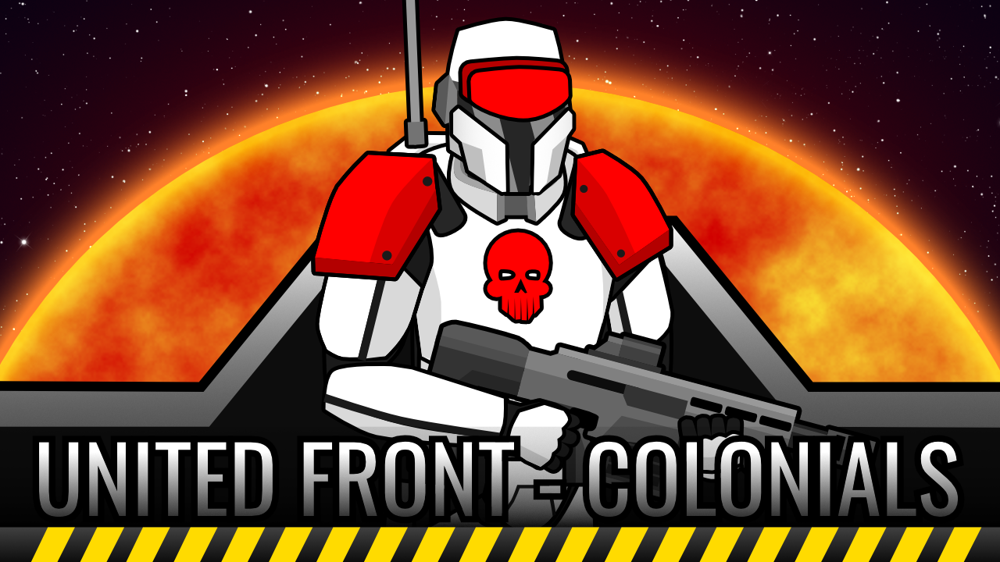

# United Front - Colonials

The United Front - Colonials is a mod which adds in 2 factions, over a dozen pieces of apparel, and tons of weapons.

The United Front adds in a new group arriving to the rimworld, which are the "Colonials" who have come to settle the planet and build up their lives on this world. Though they have not come unprepared, protected by the best armor they could afford and using advanced weapons which are state of the art, they will carve out their home and civilize this world.

## Factions

- **Colonial Administration** - A faction of colonists from a spacer civilization who are part of a colonization effort on this rimworld.
- **Colonial Militia** - A heavily armed faction from a spacer civilization who were formally part of the colonization efforts.

## Scenarios

- **Colonization Efforts** - Looking for opportunity away from home, you five have chosen to embark on a colonization effort. With the government subsidizing your efforts you arrive with decent stores of resources but will be expected to make a life here. You don't care about this though, because this spot is yours.
- **Occupation Force** - Under the orders of your government in their efforts to expand. The five of you were sent to scout this world for the eventual coming of the fleet. Equipped with the best that the army could afford your goal is to establish a foothold for those who will come later. Since you start with five armored and armed people, this is an easy start.

**Research** (in The United Front research tab):
- Colonial Fabrication Methods (prereq: Fabrication)
- Carapace Armor (prereq: Colonial Fabrication Methods)
- Medic Carapace Armor (prereq: Carapace Armor)
- Engineer Carapace Armor (prereq: Carapace Armor)
- Police Carapace Armor (prereq: Carapace Armor)
- Scout Carapace Armor (prereq: Carapace Armor)
- Assault Carapace Armor (prereq: Carapace Armor)
- Veteran Carapace Armor (prereq: Carapace Armor)
- Commander Carapace Armor (prereq: Carapace Armor)
- Colonial Uniforms (prereq: Complex Clothing)
- Modified Shields (prereq: Shield Belt)
- High-Frequency Resonators (prereq: Colonial Fabrication Methods)
- Electrothermal-Chemical Munitions (prereq: Colonial Fabrication Methods)

## Apparel

- **Carapace Armor** - A suit of armor, made up of a lightweight plasteel-weave plates which provide moderate protection and with an integrated webbing system configured for standard infantry use. Created as a cheaper alternative to power armor during conflicts. Armor like this is often used by imperial army regulars and urbworld military forces.
- **Carapace Helmet** - A armored helmet with built in communication system and a protective plasteel-weave plate. Armor like this is often used by imperial army regulars and urbworld military forces.
- **Carapace Boots** - A set of plasteel-weave plate boots. They provide decent protection and cause no hinderence to the wearer.
- **Carapace Gloves** - A set of plasteel-weave plate gloves. They provide decent protection and cause no hinderence to the wearer.
- **Medic Carapace Armor and Helmet** - A suit of armor, made up of a lightweight plasteel-weave plates which provide moderate protection and with an integrated webbing system configured for providing medical assistance in the field. Created as a cheaper alternative to power armor during conflicts. Armor like this is often used by imperial army regulars and urbworld military forces and is marked as such. **Buffs:** Medical tend quality +10%.
- **Engineer Carapace Armor and Helmet** - A suit of armor, made up of a lightweight plasteel-weave plates which provide moderate protection and with an integrated webbing system configured for combat engineering uses. Created as a cheaper alternative to power armor during conflicts. Armor like this is often used by imperial army engineers and urbworld military sappers and is marked as such. **Buffs:** Construction speed +10%.
- **Police Carapace Armor and Helmet** - A suit of armor, made up of a lightweight plasteel-weave plates which provide moderate protection and with an integrated webbing system configured for law enforcement uses. Created as a cheaper alternative to power armor during conflicts. Armor like this is often used by imperial army provosts and urbworld military judges and is marked as such. **Buffs:** Slave suppression +10%.
- **Commander Carapace Armor and Helmet** - A suit of armor, made up of higher quality lightweight plasteel-weave plates which provide more than moderate protection and with an integrated webbing system configured for command uses. Created as a cheaper alternative to power armor during conflicts. Armor like this is often used by imperial army commanders and urbworld military officers and is marked as such. **Buffs:** Social impact +15%, Psychic sensitivity +10%, Neural heat recovery +0.066.
- **Assault Carapace Armor and Helmet** - A suit of armor, made up of lightweight plasteel-weave plates which provide moderate protection, additional plates fitted for increased protection, and with an integrated webbing system configured for assault and raiding uses. Created as a cheaper alternative to power armor during conflicts. Armor like this is often used by imperial army commandos and urbworld military shocktroopers and is marked as such. **Buffs:** Melee damage +10%.
- **Scout Carapace Armor and Helmet** - A suit of armor, made up of lightweight plasteel-weave plates which provide moderate protection, featuring a bandoleer for high caliber bullets, and a thermooptical camoflague generator. Created as a cheaper alternative to power armor during conflicts. Armor like this is often used by imperial army scouts and urbworld military assassins and is marked as such. **Buffs:** Shooting accuracy +0.5.
- **Veteran Carapace Armor and Helmet** - A suit of armor, made up of a lightweight plasteel-weave plates which provide moderate protection, additional plating added in the field and with an integrated webbing system modified by veterans in the field. Created as a cheaper alternative to power armor during conflicts. Armor like this is often used by imperial army veterans and urbworld mercenaries. **Buffs:** Pain shock threshold +10%.
- **Assault Shield Belt** - A modified projectile-repulsion device. It will still attempt to stop incoming projectiles and shrapnel but has been enhanced to provide stranger protection against heat and to allow the wearer to fire while the shield is active. The cost though is that it takes longer to recharge, the shield is weaker, and shuts down instantly if hit by EMP.
- **Infantry Uniform** - A jumpsuit featuring various pockets and designed to be accomodating in most environments.
- **Beret** - A soft, round, cap made from fabrics and often used my imperial army personal and urbworld artists.
- **Commander Cap** - A hat featuring a short visor, a polished leather strap, and high quality fabrics. Often worn by imperial army commanders and urbworld dictators.

## Weapons

- **Sabot Pistol** - This high-tech, semi-automatic pistol uses electrothermal-chemical ammunition to fire larger caliber bullets at incredibly fast speeds. The bullets are designed like sabots, providing significant armor penetration. Its compact size and reliability makes it an ideal side arm for close quarters combat.
- **Sabot Shotgun** - A high-tech shotgun designed using electrothermal-chemical shells. To maintain velocity improvements, it fires flechettes rather than shot, delivering powerful damage and armor penetration at close range. Magazine fed, it can fire rapidly, making it ideal for close quarters combat and personal defense.
- **Sabot Assault Rifle** - A service rifle that uses electrothermal-chemical ammunition to fire high power sabots. The sabots are firing at incredibly high velocity which grants it immense armor penetration. The accuracy and reliability has made this rifle quite common among spacer factions.
- **Sabot Sniper Rifle** - A specialized electrothermal-chemical rifle designed for extreme-ranges and anti-tank usage. It fires large caliber sabots designed for killing tanks, delivering high damage and armor penetration at massive distance. The heft of the weapon though makes it unwieldy to fire unless you are in a stable firing position.
- **Sabot Autocannon** - A massive electrothermal-chemical rotary cannon converted to portable use. It fires anti-tank sabots in devastating bursts. The mass makes it difficult to use for even enhanced soldiers, it is unrivaled in its capacity to destroy everything in front of it.
- **Frequency Knife** - A composite plasteel dagger fitted with a small resonator which vibrates the blade at high frequencies. The oscillation of the blade can weaken molecular structures, but the shortness of the blade and small resonator render it not as effective.
- **Frequency Sword** - A compositie plasteel sword fitted with a resonator which vibrates the blade at high frequencies. The oscillation of the blade weakens the molecular structure of anything that it cuts, though it is quite heavy.
- **Frequency Spear** - A composite plasteel spear fitted with an overclocked resonator which vibrates the spearhead at incredibly high frequencies. The oscillation of the blade can not only weaken molecular structures but shatter them. The length of the weapon provides great reach but the weight prevents all but the best from using effectively.
- **Frequency Club** - A composite plasteel club fitted with a resonator which vibrates the head at high frequencies. The oscillation of the head weakens molecular structure of anything it hits often shattering its targets, though it is quite heavy.
- **Frequency Hammer** - A composite plasteel warhammer fitted with a overclocked resonator which vibrates the head at incredibly high frequencies. The oscillation of the head can not only weaken armor but with the right strike can shatter armor into pieces. The weight of the weapon provides an increased effect on strikes but it is slow to use.
- **Frequency Greatsword** - A composite plasteel greatsword fitted with an overclocked resonator which vibrates the blade at incredibly high frequencies. The oscillation of the blade not only weakens molecular bonds but with the additional weight can push ever further with cuts. The weight of the weapon requires a skilled warrior to use it effectively.
- **Unique Sabot Rifle** (Odyssey) - A sabot rifle with customized parts.
- **Unique Sabot Shotgun** (Odyssey) - A sabot shotgun with customized parts.
- **Pulse Rifle** (with Xenomorphtypes) - A pulse action rifle fitted with an underbarrel grenade launcher. A versatile combat rifle favored by imperial and colonial marine groups. Decent power and range though slower than other weapons.

## Extras

- **Armaments Bench** - A workbench equipped with advanced tools for producing equipment favored by spacer factions.
- **Promachus** - A manufactured cocktail of alcohol, painkillers, and radioactive materials for usage by assault troops. It possesses a chemically sweet flavor, though it should not be drunk recreationally. Excessive consumption can lead to alcohol blackouts, seizures, psychosis, addiction, and even death.

## Combat Extended

United Front - Colonials has built-in Combat Extended support, no separate patch needed.

| Weapon | Ammo | Role |
|---|---|---|
| Sabot Pistol | 5x32mm ETC (12) | Sidearm |
| Sabot Shotgun | 20x55mm ETC (6) | Close quarters |
| Sabot Assault Rifle | 8x48mm ETC (30) | Assault rifle |
| Sabot Sniper Rifle | 14x80mm ETC (5) | Long-range precision |
| Sabot Autocannon | 14x80mm ETC (30) | Heavy support |
| Pulse Rifle (with Xenomorphtypes) | 4.73x33mm Caseless (95) | Assault rifle with grenade launcher |

## FAQ

**Why do they look like knockoff Clone/Storm Troopers?**  
Because I wanted to make them paintable and so everything is white and masked to make it so. Which is 90% of what Clone/Stormtrooper designs.

**Can you make a patch for another mod?**  
Post it in the suggestions thread. I'm happy to patch conflicts or mods that would benefit from it.

**I don't like something, fix it!**  
Learn how to make a patch and change it yourself.

**I have a suggestion/improvement!**  
Leave a comment, if I make a thread for it people will never use it.

## Credits

**Karbonpanzer** - Coder, artist and editor  
**Orion** - Big thanks for the Shader even though I did not use it this go around.  
**Aelanna** - For the tips about sourcing sounds for weapons.  
**Ludeon Studios** - For Great Game and the Star Art used in the Preview image.  

[GitHub repository](https://github.com/karbonpanzer/United-Front-Colonials)

Code licensed under LGPL. Art licensed under CC BY-NC-SA 4.0.
