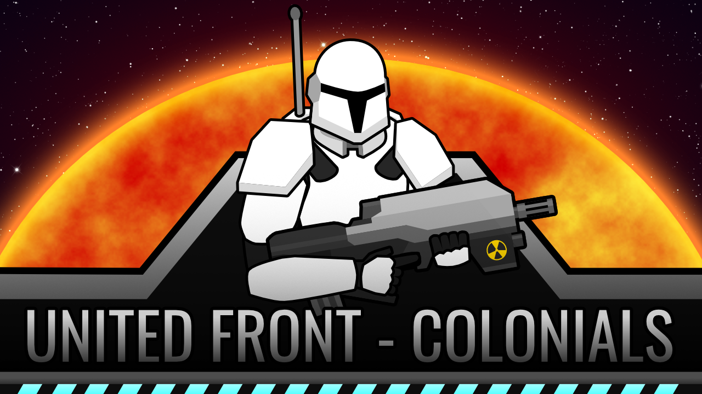 

The United Front - Colonials is a mod which adds in 2 factions, over a dozen pieces of apparel, and tons of weapons.

The United Front adds in a new group arriving to the rimworld, which are the "Colonials" who have come to settle the planet and build up their lives on this world. Though they have not come unprepared, protected by the best armor they could afford and using advanced weapons which are state of the art, they will carve out their home and civilize this world.

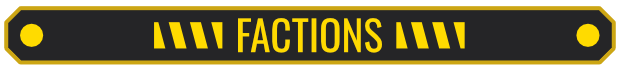 
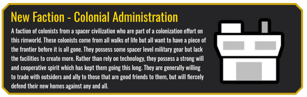 
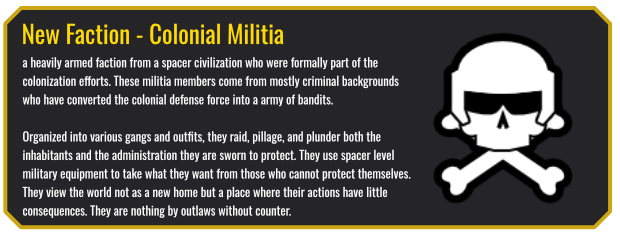 

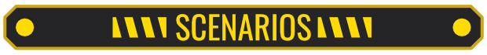 
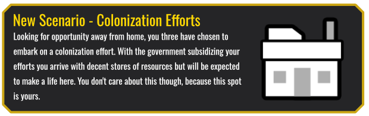 
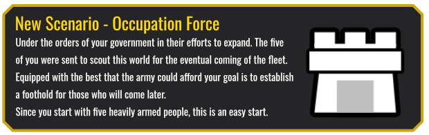 

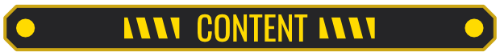 
 

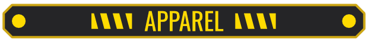 
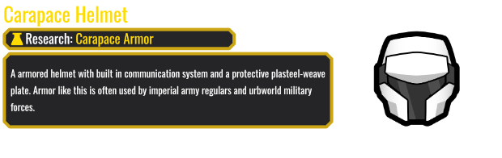 
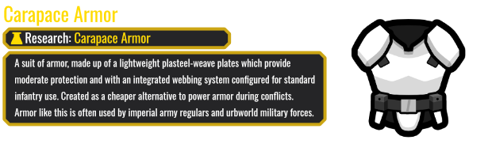 
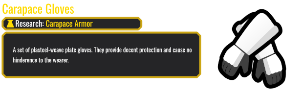 
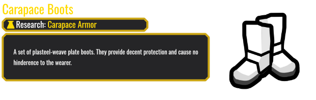 
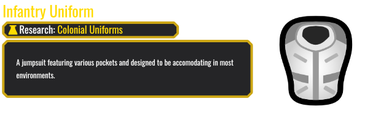 
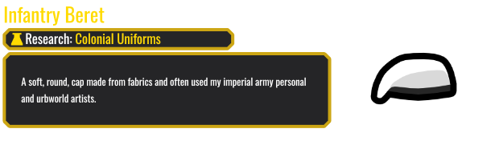 
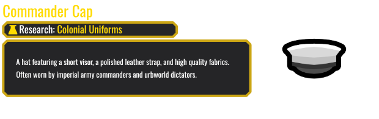 
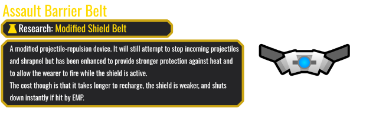 

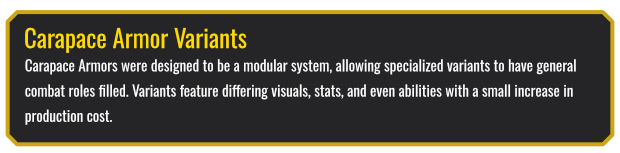 
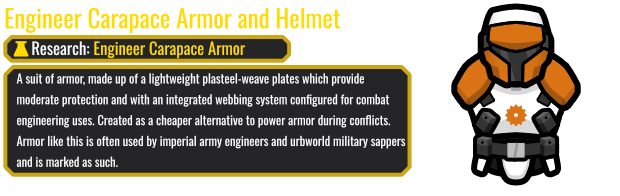 
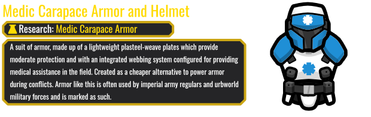 
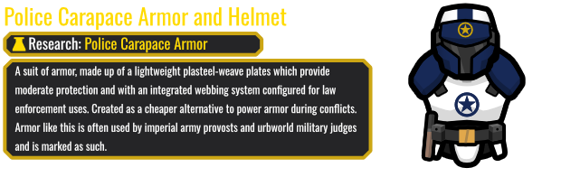 
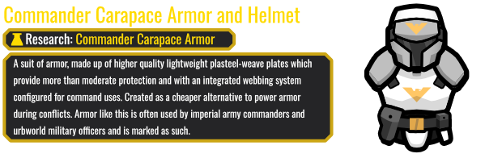 
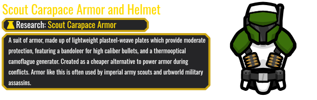 
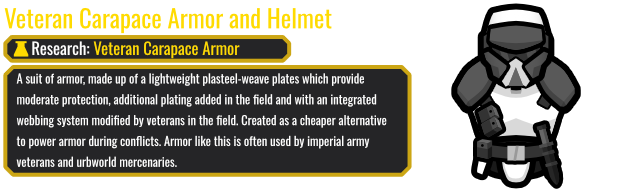 
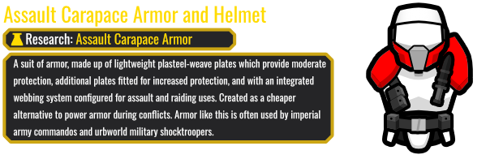 
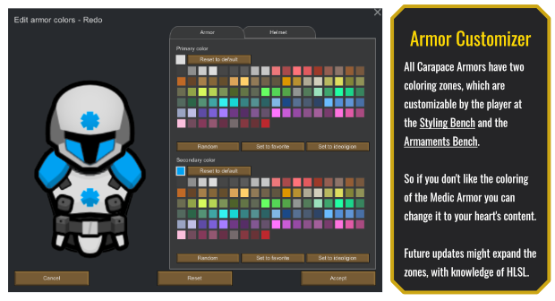 

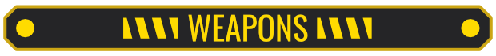 
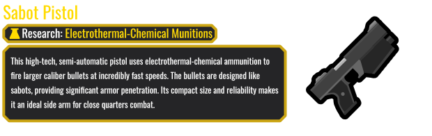 
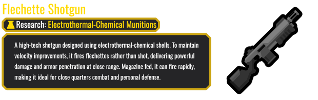 
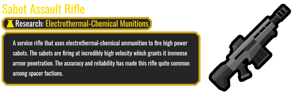 
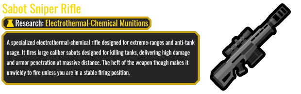 
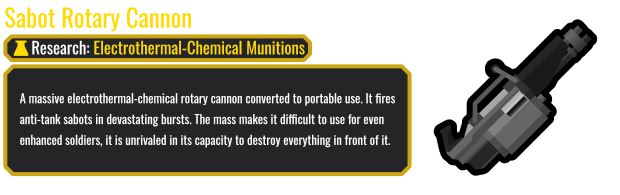 
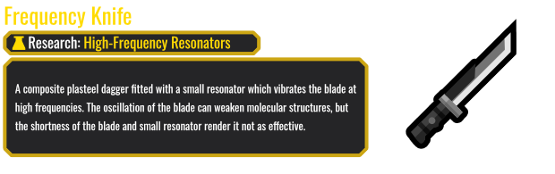 
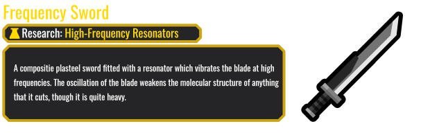 
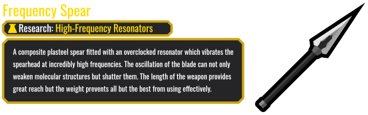 
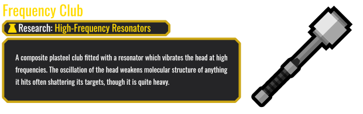 
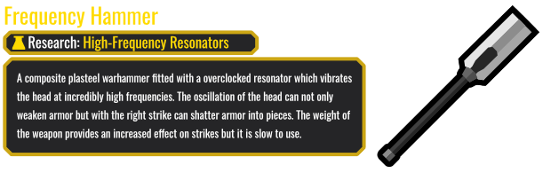 
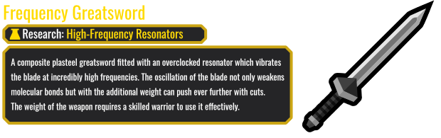 

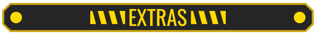 
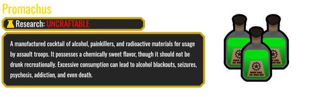 

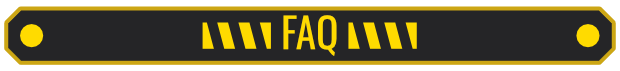 

<b>Why do they look like knockoff Clone/Storm Troopers?</b> Because I wanted to make them paintable and so everything is white and masked to make it so. Which is 90% of what Clone/Stormtrooper designs.

<b>Where is the CE Patch?</b> Included, kinda rough but I am not a CE user.

<b>Besides CE, can you make a patch for x,y, or z?</b> Post it in the suggestion thread! I am more than happy to make a patch if an error occurs between mods or you think that it would benefit from having patch.

<b>I have a variant idea! Where can I put it?</b> Post it in the suggestions thread. Otherwise I don't get notifications for it and it will fall in the cracks and be gone forever.

<b>I don't like x,y, or z, fix it!</b> Learn how to make a patch and change it yourself.

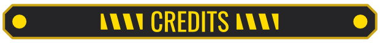 

<b>Karbonpanzer</b>: Coder/Artist/Editor <b>Orion</b>: Big thanks for the Shader even though I did not use it this go around. <b>Aelanna</b>: For the tips about sourcing sounds for weapons. <b>Ludeon Studios</b>: For Great Game and the Star Art used in the Preview image.

(LGPL) (CC BY-NC-SA 4.0)

