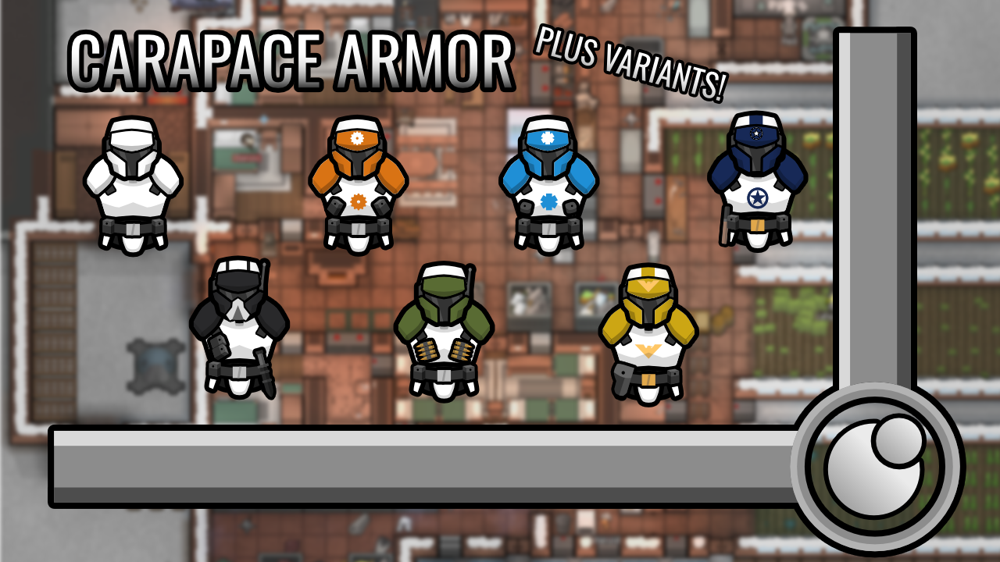
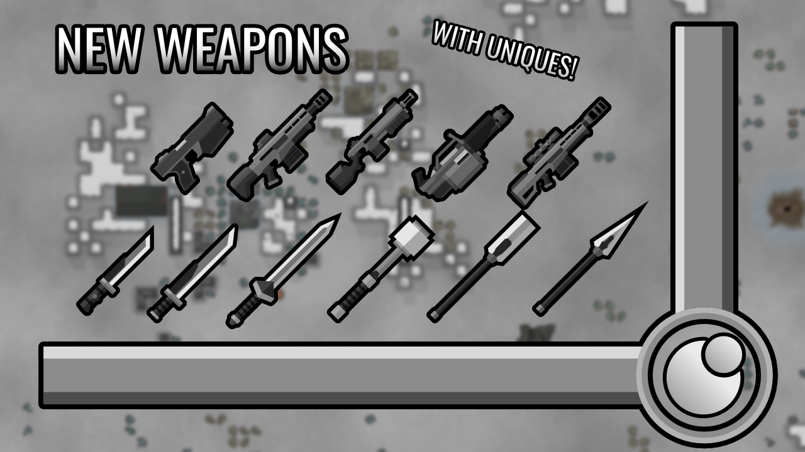
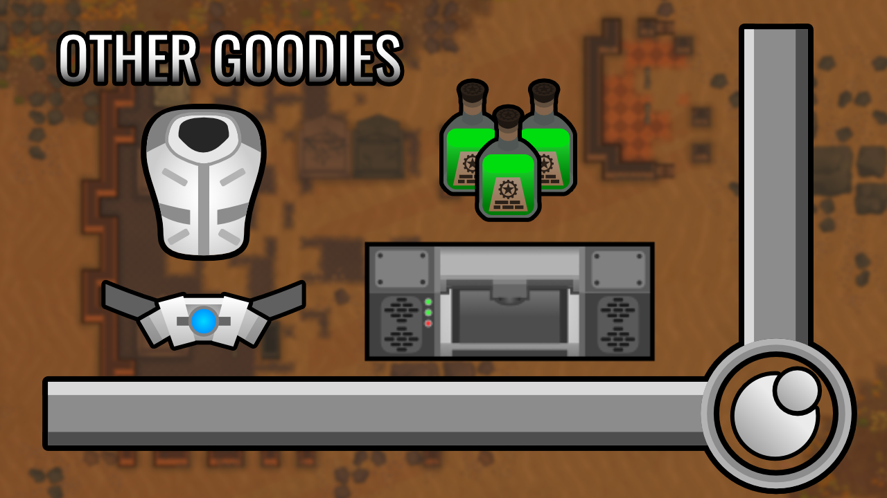

# United Front - Colonials

The United Front - Colonials is a mod which adds in 2 factions, over a dozen pieces of apparel, and tons of weapons.

The United Front adds in a new group arriving to the rimworld, which are the "Colonials" who have come to settle the planet and build up their lives on this world. Though they have not come unprepared, protected by the best armor they could afford and using advanced weapons which are state of the art, they will carve out their home and civilize this world.

## Factions

- **Colonial Administration** - A faction of colonists from a spacer civilization who are part of a colonization effort on this rimworld.
- **Colonial Militia** - A heavily armed faction from a spacer civilization who were formally part of the colonization efforts.

## Scenarios

- **Colonization Efforts** - Looking for opportunity away from home, you five have chosen to embark on a colonization effort.
- **Occupation Force** - Under the orders of your government in their efforts to expand. The five of you were sent to scout this world for the eventual coming of the fleet.

**Research** (in The United Front research tab):
- Colonial Fabrication Methods (prereq: Fabrication)
- Carapace Armor (prereq: Colonial Fabrication Methods)
- Medic Carapace Armor (prereq: Carapace Armor)
- Engineer Carapace Armor (prereq: Carapace Armor)
- Police Carapace Armor (prereq: Carapace Armor)
- Scout Carapace Armor (prereq: Carapace Armor)
- Assault Carapace Armor (prereq: Carapace Armor)
- Veteran Carapace Armor (prereq: Carapace Armor)
- Commander Carapace Armor (prereq: Carapace Armor)
- Colonial Uniforms (prereq: Complex Clothing)
- Modified Shields (prereq: Shield Belt)
- High-Frequency Resonators (prereq: Colonial Fabrication Methods)
- Electrothermal-Chemical Munitions (prereq: Colonial Fabrication Methods)

## Apparel

- **Carapace Armor** - A suit of armor, made up of a lightweight plasteel-weave plates which provide moderate protection and with an integrated webbing system configured for standard infantry use. Created as a cheaper alternative to power armor during conflicts. Armor like this is often used by imperial army regulars and urbworld military forces.
- **Carapace Helmet** - A armored helmet with built in communication system and a protective plasteel-weave plate. Armor like this is often used by imperial army regulars and urbworld military forces.
- **Carapace Boots** - A set of plasteel-weave plate boots. They provide decent protection and cause no hinderence to the wearer.
- **Carapace Gloves** - A set of plasteel-weave plate gloves. They provide decent protection and cause no hinderence to the wearer.
- **Medic Carapace Armor and Helmet** - Medical tend quality +10%.
- **Engineer Carapace Armor and Helmet** - Construction speed +10%.
- **Police Carapace Armor and Helmet** - Slave suppression +10%.
- **Commander Carapace Armor and Helmet** - Social impact +15%, psychic sensitivity +10%, neural heat recovery +0.066.
- **Assault Carapace Armor and Helmet** - Melee damage +10%. Can throw frag grenades (8 charges, refilled with frag grenades).
- **Scout Carapace Armor and Helmet** - Shooting accuracy +0.5. Grants the stealth field ability, turning the wearer invisible for a short time; using a weapon collapses the field.
- **Veteran Carapace Armor and Helmet** - Pain shock threshold +10%.
- **Assault Shield Belt** - A modified projectile-repulsion device. It will still attempt to stop incoming projectiles and shrapnel but has been enhanced to provide stranger protection against heat and to allow the wearer to fire while the shield is active. The cost though is that it takes longer to recharge, the shield is weaker, and shuts down instantly if hit by EMP.
- **Infantry Uniform** - A jumpsuit featuring various pockets and designed to be accomodating in most environments.
- **Beret** - A soft, round, cap made from fabrics and often used my imperial army personal and urbworld artists.
- **Commander Cap** - A hat featuring a short visor, a polished leather strap, and high quality fabrics. Often worn by imperial army commanders and urbworld dictators.

## Weapons

- **Sabot Pistol** - This high-tech, semi-automatic pistol uses electrothermal-chemical ammunition to fire larger caliber bullets at incredibly fast speeds.
- **Sabot Shotgun** - A high-tech shotgun designed using electrothermal-chemical shells. +Unique variant available (Odyssey).
- **Sabot Assault Rifle** - A service rifle that uses electrothermal-chemical ammunition to fire high power sabots. +Unique variant available (Odyssey).
- **Sabot Sniper Rifle** - A specialized electrothermal-chemical rifle designed for extreme-ranges and anti-tank usage.
- **Sabot Autocannon** - A massive electrothermal-chemical rotary cannon converted to portable use.
- **Frequency Knife** - A composite plasteel dagger fitted with a small resonator which vibrates the blade at high frequencies.
- **Frequency Sword** - A compositie plasteel sword fitted with a resonator which vibrates the blade at high frequencies.
- **Frequency Spear** - A composite plasteel spear fitted with an overclocked resonator which vibrates the spearhead at incredibly high frequencies.
- **Frequency Club** - A composite plasteel club fitted with a resonator which vibrates the head at high frequencies. Its strikes also deal EMP damage.
- **Frequency Hammer** - A composite plasteel warhammer fitted with a overclocked resonator which vibrates the head at incredibly high frequencies.
- **Frequency Greatsword** - A composite plasteel greatsword fitted with an overclocked resonator which vibrates the blade at incredibly high frequencies.
- **Pulse Rifle** (with Xenomorphtypes) - A pulse action rifle fitted with an underbarrel grenade launcher.

## Extras

- **Armaments Bench** - A workbench equipped with advanced tools for producing equipment favored by spacer factions.
- **Promachus** - A manufactured cocktail of alcohol, painkillers, and radioactive materials for usage by assault troops.

## Combat Extended

United Front - Colonials has built-in Combat Extended support, no separate patch needed.

| Weapon | Ammo | Role |
|---|---|---|
| Sabot Pistol | 5x32mm ETC (12) | Sidearm |
| Sabot Shotgun | 20x55mm ETC (6) | Close quarters |
| Sabot Assault Rifle | 8x48mm ETC (30) | Assault rifle |
| Sabot Sniper Rifle | 14x80mm ETC (5) | Long-range precision |
| Sabot Autocannon | 14x80mm ETC (30) | Heavy support |
| Pulse Rifle (with Xenomorphtypes) | 4.73x33mm Caseless (95) | Assault rifle with grenade launcher |

## FAQ

**Why do they look like knockoff Clone/Storm Troopers?**  
Because I wanted to make them paintable and so everything is white and masked to make it so. Which is 90% of what Clone/Stormtrooper designs.

**Can you make a patch for another mod?**  
Post it in the suggestions thread. I'm happy to patch conflicts or mods that would benefit from it.

**I don't like something, fix it!**  
Learn how to make a patch and change it yourself.

**I have a suggestion/improvement!**  
Leave a comment, if I make a thread for it people will never use it.

## Credits

**Karbonpanzer** - Coder, artist and editor  
**Orion** - Big thanks for the Shader even though I did not use it this go around.  
**Aelanna** - For the tips about sourcing sounds for weapons.  
**Ludeon Studios** - For Great Game and the Star Art used in the Preview image.  

[GitHub repository](https://github.com/karbonpanzer/United-Front-Colonials)

Code licensed under LGPL. Art licensed under CC BY-NC-SA 4.0.
